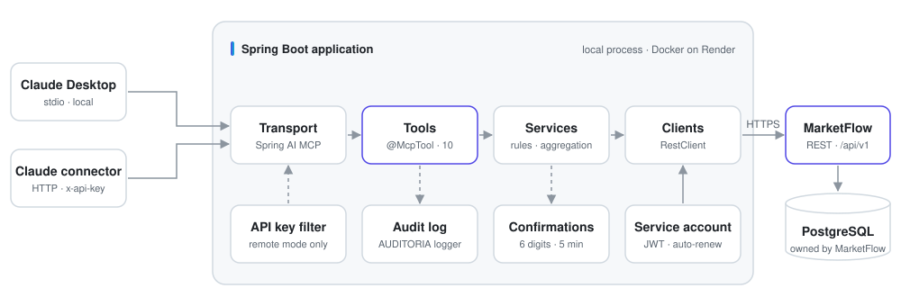
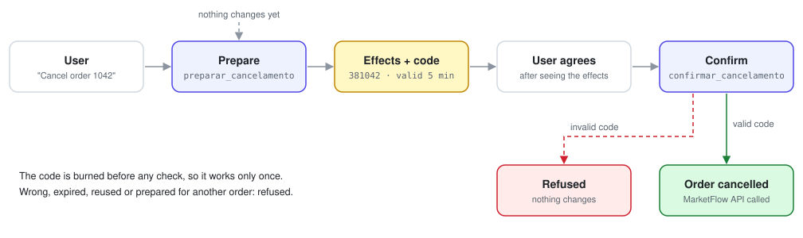

# MarketFlow MCP

An MCP (Model Context Protocol) server built with Java 21, Spring Boot 4 and Spring AI 2 that lets Claude query and operate the [MarketFlow](https://github.com/YuriErnani/marketflow) e-commerce API through a closed set of tools, with two-step confirmation for every write, audit logging and data minimization.


[MarketFlow API](https://github.com/YuriErnani/marketflow) · [Tools](#tools) · [Safety by design](#safety-by-design) · [Getting started](#getting-started) · [Engineering decisions](#engineering-decisions)

> [!NOTE]
> The remote server runs on Render's free tier, at `https://marketflow-mcp.onrender.com/mcp`, and requires an API key. After 15 minutes without traffic, both this server and the MarketFlow API sleep, so the first request can take about a minute.

## Table of contents

- [Overview](#overview)
- [How it works](#how-it-works)
- [Tools](#tools)
- [Safety by design](#safety-by-design)
- [Engineering decisions](#engineering-decisions)
- [Tech stack](#tech-stack)
- [Getting started](#getting-started)
- [Configuration](#configuration)
- [Deployment](#deployment)
- [Testing](#testing)
- [Project structure](#project-structure)
- [Limitations and roadmap](#limitations-and-roadmap)
- [Author](#author)

## Overview

MarketFlow MCP is a bridge between Claude and the MarketFlow REST API. You ask Claude things like:

- *"Which orders are awaiting payment?"*
- *"Which products are running low on stock?"*
- *"Cancel order 1042."*

Claude picks one of the server's tools, the server calls the MarketFlow API with its own service account, and only the fields Claude needs come back.

The server **does not call any AI model** and needs no AI API key. The reasoning happens in Claude. This project is the bridge: the tools, the security around them and the integration with an authenticated API.

> [!NOTE]
> The domain language is Portuguese, as in MarketFlow, so tool names and fields use Portuguese names, such as `buscar_produtos` (search products), `pedido` (order) and `estoque` (stock).

## How it works

<picture>
  <source media="(prefers-color-scheme: dark)" srcset="docs/images/architecture-dark.svg">
  
</picture>

The same application runs in two modes, selected by a Spring profile:

| Mode | Transport | Who starts it | Used by |
| :--- | :--- | :--- | :--- |
| Local (default) | stdio: JSON-RPC over the process console | Claude Desktop, from `claude_desktop_config.json` | Claude Desktop on the same machine |
| Remote (`remoto` profile) | Streamable HTTP at `/mcp`, protected by an API key | Render, from the Docker image | A Claude custom connector, from Anthropic's cloud |

Inside, each domain module follows the same layers as MarketFlow:

| Layer | Responsibility |
| :--- | :--- |
| `tool` | MCP tools exposed to Claude (`@McpTool`). Validates input and translates errors |
| `service` | Rules that live in the MCP: aggregation limits, status filtering, two-step confirmation |
| `client` | Calls to the MarketFlow API with `RestClient` |
| `dto` | Records and enums, with only the fields Claude needs |

**Modules:** `produto` (products), `estoque` (stock) and `pedido` (orders). The `infra` package holds the HTTP clients, service account login, API key security, auditing, error translation and validation.

## Tools

| Tool | What it does | Type | MarketFlow access |
| :--- | :--- | :--- | :--- |
| `buscar_produtos` | Searches the catalog by name, category and price range, paginated | Read | Public |
| `consultar_saldo_produto` | Available and reserved stock for one product | Read | Admin |
| `historico_estoque` | Stock movements for one product, newest first | Read | Admin |
| `listar_estoque_baixo` | Active products with available stock below a limit, lowest first | Read | Public + Admin |
| `consultar_pedido` | One order with its items | Read | Admin |
| `listar_pedidos` | Orders, newest first, with an optional status filter | Read | Admin |
| `preparar_cancelamento` | Checks whether an order can be cancelled, describes the effects and returns a confirmation code | Prepare (no changes) | Admin |
| `confirmar_cancelamento` | Cancels the order with the confirmation code | **Write** | Admin |
| `preparar_atualizacao_status` | Checks whether the next status is allowed, describes the effects and returns a confirmation code | Prepare (no changes) | Admin |
| `confirmar_atualizacao_status` | Advances the order status with the confirmation code | **Write** | Admin |

Read and prepare tools carry `readOnlyHint = true`. Write tools carry `destructiveHint = true` and `idempotentHint = false`, so MCP clients can warn the user before running them.

## Safety by design

Giving an AI model "hands" on a real system is the core concern of this project.

**A closed set of actions.** There is no free-form SQL, no generic HTTP passthrough and no delete. Claude can only call the ten tools above.

**Two-step confirmation for every write.**

<picture>
  <source media="(prefers-color-scheme: dark)" srcset="docs/images/two-step-confirmation-dark.svg">
  
</picture>

| Rule | Protects against |
| :--- | :--- |
| The code expires in 5 minutes | Confirming something prepared long ago, when the order may have changed |
| The code is single-use, and burned even when a check fails | Repeating the same action by accident |
| The code is bound to the action, the order and, for status changes, the target status | Preparing order 1042 and confirming order 1024, or preparing `ENVIADO` and confirming `ENTREGUE` |
| Invalid preparations are refused before a code exists | Codes for orders that can't be cancelled, or for skipped status steps |

The two steps make sure the effects are **shown** before anything changes. The guarantee that a **human agreed** comes from the client's tool approval prompt, so write tools should never be set to "always allow".

**Audit log.** Every prepare and confirm call writes a line to a dedicated `AUDITORIA` logger with the tool, its parameters and the outcome (`SUCESSO` or `FALHA` with the reason). Confirmation codes, tokens and passwords are never logged.

**Data minimization and prompt injection.** DTOs keep only the fields Claude needs. The product `descricao` and the order `enderecoEntrega` are dropped on arrival: one is free text written by an admin, the other is a customer's personal data, and both are free text that could carry instructions aimed at the model. Data that comes from MarketFlow is data, never instructions.

**Input validation.** Every parameter is checked before any HTTP call: positive IDs, non-negative pages, limits within a range, a consistent price range, bounded text length and a 6-digit code format.

**Clear errors.** MarketFlow's Problem Details (RFC 9457) are translated into their `detail` message, `401`/`403`/`5xx` and connection failures into fixed messages, without internal details.

**Remote mode protection.**

- Every request must carry the `x-api-key` header, checked by a Spring Security filter with a constant-time comparison (`MessageDigest.isEqual`).
- Requests without a valid key get an empty `401`.
- The server refuses to start in remote mode without a key of at least 32 characters.
- Sessions are stateless, and CSRF is off because no cookies are used.

**Secrets only in environment variables.** The service account credentials and the API key are never in code, logs or the repository.

## Engineering decisions

| Problem | Decision |
| :--- | :--- |
| MarketFlow has no endpoint to list low-stock products | `listar_estoque_baixo` combines the product list with one stock call per product (1 + N requests), capped at 100 products and flagged with `listaIncompleta`. In production, a dedicated endpoint would be the right fix |
| MarketFlow can't filter orders by status | Filtering in the MCP over the 200 most recent orders, with `pedidosAnalisados` and `listaIncompleta` in the response |
| Admin requests see inactive products | Two `RestClient` beans: a public one (`@Primary`) for the catalog and an admin one with a Bearer token interceptor |
| JWT valid for 2 hours | Lazy login with renewal after 110 minutes, synchronized so concurrent calls don't log in twice |
| MarketFlow has only `ADMIN` and `CLIENTE` roles | A dedicated service account, separate from the main admin. The risk is reduced by the closed tool list, two-step writes and auditing |
| A change in MarketFlow's JSON contract | Required fields are Java primitives, so a missing field fails loudly instead of reaching Claude as `null` |
| stdio uses the console as the protocol channel | No banner, console logging off and logs written to a file in local mode |
| One codebase, two transports | `spring-ai-starter-mcp-server-webmvc` provides both. The default properties select stdio with no web server, and the `remoto` profile selects Streamable HTTP |
| Testing expiration without waiting 5 minutes | `ConfirmacaoService` takes a `Clock`, replaced by a controllable clock in tests |
| Status rules | The MCP mirrors MarketFlow's one-step progression (`PAGAMENTO_APROVADO → EM_PREPARACAO → ENVIADO → ENTREGUE`) to describe effects up front. MarketFlow still validates and has the final say |

## Tech stack

| Area | Technology |
| :--- | :--- |
| Language | Java 21 |
| Framework | Spring Boot 4.1 (Web MVC, Security), Spring AI 2.0 (MCP server, `@McpTool`) |
| MCP transports | stdio and Streamable HTTP |
| HTTP client | Spring `RestClient` |
| Testing | JUnit 5, AssertJ, Mockito, MCP Inspector |
| Packaging and deployment | Maven, Docker, Render |
| Upstream API | [MarketFlow API](https://github.com/YuriErnani/marketflow) (Spring Boot, PostgreSQL) |

## Getting started

### Prerequisites

- JDK 21
- A running MarketFlow API (local with Docker Compose, or the live demo)
- A MarketFlow user for the service account with the `ADMIN` role. MarketFlow creates only customers through its API, so promote the account in the database:

```sql
UPDATE usuarios SET perfil = 'ADMIN' WHERE email = 'mcp-service@marketflow.dev';
```

### 1. Build

```bash
./mvnw clean package
```

On Windows PowerShell, use `.\mvnw.cmd clean package`. The build runs the unit tests and creates `target/marketflow-mcp-0.0.1-SNAPSHOT.jar`.

### 2. Local mode with Claude Desktop

Open Claude Desktop's configuration (**Settings → Developer → Edit Config**) and add the server, with absolute paths:

```json
{
  "mcpServers": {
    "marketflow-mcp": {
      "command": "C:\\path\\to\\jdk-21\\bin\\java.exe",
      "args": ["-jar", "C:\\path\\to\\marketflow-mcp\\target\\marketflow-mcp-0.0.1-SNAPSHOT.jar"],
      "env": {
        "MARKETFLOW_API_URL": "http://localhost:8080",
        "MARKETFLOW_EMAIL": "mcp-service@marketflow.dev",
        "MARKETFLOW_SENHA": "your-service-account-password"
      }
    }
  }
}
```

Quit Claude Desktop completely and open it again. Logs are written to `~/marketflow-mcp-logs/marketflow-mcp.log`.

> [!IMPORTANT]
> On Windows, quit Claude Desktop before rebuilding: while it runs the server, the JAR is locked.

### 3. Remote mode on your machine

```powershell
$env:MARKETFLOW_EMAIL = "mcp-service@marketflow.dev"
$env:MARKETFLOW_SENHA = Read-Host "Service account password"
$env:MCP_API_KEY = "<a random key with at least 32 characters>"
java -jar target/marketflow-mcp-0.0.1-SNAPSHOT.jar --spring.profiles.active=remoto --server.address=127.0.0.1
```

The server listens on `http://localhost:8081/mcp`.

### 4. Inspect it

```bash
npx @modelcontextprotocol/inspector --server-url http://localhost:8081/mcp --transport http --header "x-api-key: <your key>"
```

The MCP Inspector lists the tools with their schemas and annotations, calls them and shows the JSON-RPC traffic.

## Configuration

| Variable | Description | Default |
| :--- | :--- | :--- |
| `MARKETFLOW_API_URL` | Base URL of the MarketFlow API | `http://localhost:8080` |
| `MARKETFLOW_EMAIL` | Service account e-mail | none |
| `MARKETFLOW_SENHA` | Service account password | none |
| `MCP_API_KEY` | API key for remote mode, at least 32 characters | none, and remote mode refuses to start without it |
| `SPRING_PROFILES_ACTIVE` | `remoto` for Streamable HTTP | none (stdio) |
| `PORT` | HTTP port in remote mode | `8081` |

To generate an API key:

```bash
# Linux/macOS
openssl rand -hex 32

# PowerShell
$bytes = New-Object byte[] 32
[Security.Cryptography.RandomNumberGenerator]::Create().GetBytes($bytes)
-join ($bytes | ForEach-Object { $_.ToString("x2") })
```

## Deployment

**Render.** The multi-stage `Dockerfile` builds the JAR with Maven and runs it on a JRE image as a non-root user, with `SPRING_PROFILES_ACTIVE=remoto`. Create a Docker web service from this repository and set `MARKETFLOW_API_URL`, `MARKETFLOW_EMAIL`, `MARKETFLOW_SENHA` and `MCP_API_KEY` as environment variables. Render provides `PORT`.

The service account must exist, with the `ADMIN` role, in the database of the MarketFlow instance the server points to. Use a different password from your local one.

**Claude custom connector.** In Claude, add a custom connector with:

- **URL:** `https://<your-service>.onrender.com/mcp`
- **Authentication:** *No sign-in*
- **Request headers:** `x-api-key` with your key, marked as required

> [!NOTE]
> Request header authentication for custom connectors is in beta and may not be available on every account. Without the header, the server answers `401`, and Claude tries an OAuth flow that this server does not provide.

## Testing

```bash
./mvnw test
```

32 unit tests, with no MarketFlow or network required:

| Test class | What it covers |
| :--- | :--- |
| `ConfirmacaoServiceTest` | Code format, single use, expiration with a controllable clock, codes bound to the order and the action, codes burned on mismatch |
| `PedidoServiceTest` | Cancellation effects for paid and unpaid orders, refusal for delivered orders, no MarketFlow call with another order's code, no skipped status steps, no status change different from the prepared one (with a Mockito mock of the client) |
| `ValidacaoTest` | Every validation rule, including the boundaries |

The server was also tested end to end with the MCP Inspector (stdio and HTTP), Claude Desktop and a Claude custom connector.

## Project structure

```text
docs/images/         # README diagrams
src/main/java/br/com/marketflow/mcp
├── estoque          # stock tools, low-stock aggregation
├── pedido           # order tools, status filter, two-step confirmation
├── produto          # catalog search
└── infra
    ├── auditoria      # AUDITORIA logger
    ├── configuration  # public and admin RestClients
    ├── dto            # shared pagination record
    ├── exception      # Problem Details translation
    ├── security       # service account login, API key filter, remote security config
    └── validacao      # input validation
```

## Limitations and roadmap

Known limitations:

- The service account has the `ADMIN` role, because MarketFlow has no narrower role.
- Low-stock and status queries aggregate in the MCP and are capped, so very large catalogs or order histories are only partly analyzed (the response says so).
- Confirmation codes live in memory: they are lost on restart, and the design assumes a single instance.
- If MarketFlow's JWT secret changes, the cached token stays invalid until the server restarts.
- For malformed MCP requests, Spring AI's transport returns the exception with its stack trace. Only requests that already passed the API key check can reach it.
- The effect descriptions mirror MarketFlow's rules and must be kept in sync if those rules change.

Planned improvements:

- [ ] A limited service role in MarketFlow for MCP operations
- [ ] A MarketFlow endpoint for low stock, replacing the 1 + N aggregation
- [ ] Drop the cached token and log in again on `401`
- [ ] OAuth for the remote connector
- [ ] Hide stack traces in transport error responses
- [ ] Demo recording

## Author

**Yuri Ernani** · [GitHub](https://github.com/YuriErnani)
